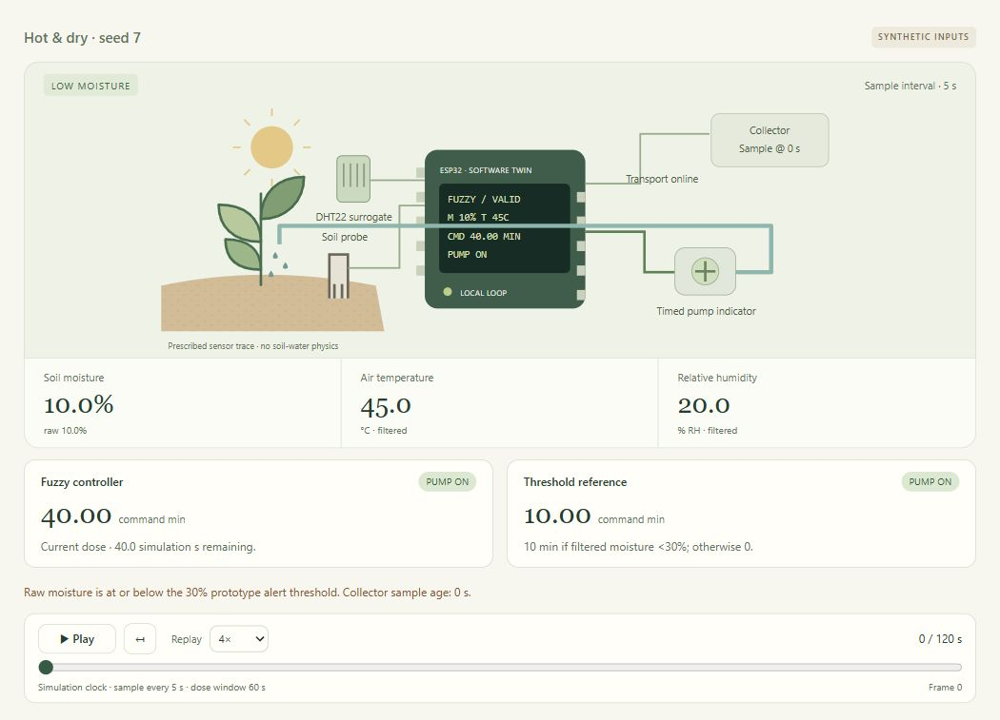
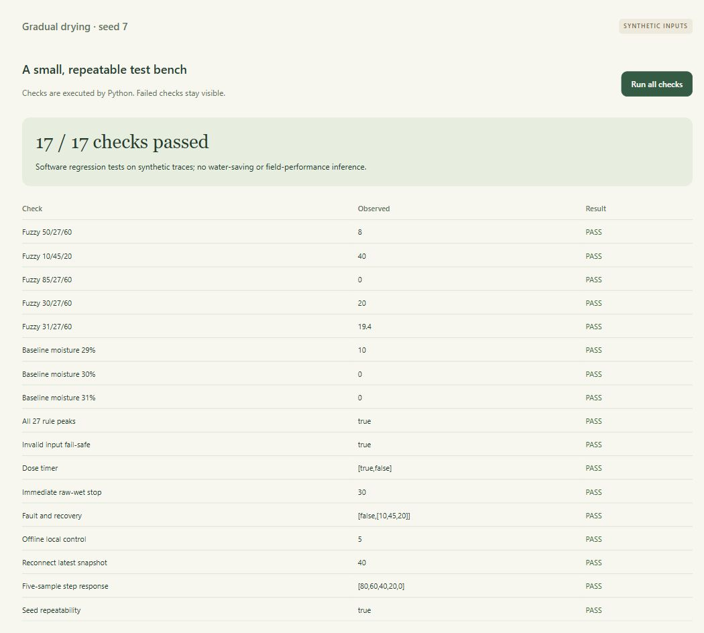
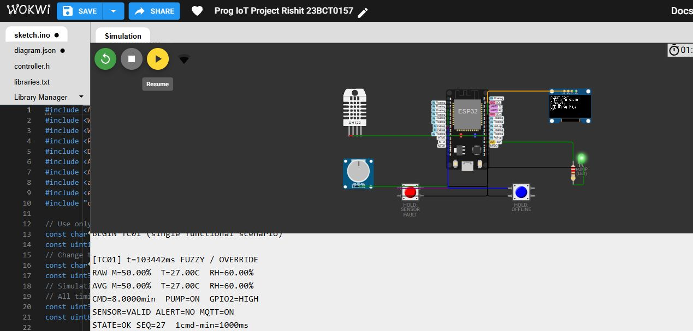
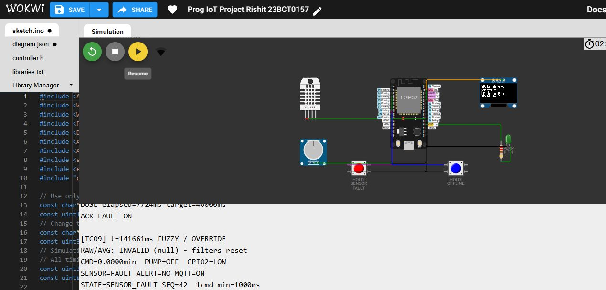

# SmartAgri

An ESP32 agriculture prototype with a Streamlit dashboard, a reproducible browser simulator and a tested Wokwi circuit. **Rishit Chaudhary (23BCT0157)** and **Siddharth Verma (23BCT0159)**. Faculty supervisor: Dr. Syamasudha Veeragandham.

[Open Wokwi](https://wokwi.com/projects/478323582523545601) · [Editable research paper](research/ProgIoT%20DA-7%20Research%20Paper%20Rishit%2023BCT0157.docx) · [Review submissions](reviews/SUBMISSION_GUIDE.md) · [Wokwi evidence](docs/wokwi-evidence/README.md)

Reported control experiments use synthetic inputs, accelerated timers and an LED pump surrogate. Public-dataset crop scores have not been validated against physical soil sensors or field crop suitability.

## Screenshots

**Dashboard accounts**


**Browser control and executed checks**





**Wokwi circuit with Serial output**





Additional figures, all 18 firmware cases and actual MQTT receipts are in [docs](docs/).

## Run the browser simulator

```powershell
git clone https://github.com/rizzit17/SmartAgri.git
cd SmartAgri
python simulator/server.py
```

Open **http://127.0.0.1:8766** and keep the terminal running. On Windows, `Start-Simulator.cmd` does the same. The core engine needs only the Python standard library, without a broker or account.

Four views expose field replay, signals/rules, a test bench and a separate crop experiment. Nine presets cover normal, hot/dry, wet, boundary, wet step, sensor fault, network loss, noisy input and drying conditions. See [simulator/README.md](simulator/README.md).

Optional crop experiment:

```powershell
python -m pip install -r simulator/requirements-ml.txt
python simulator/train_model.py
python simulator/server.py
```

Train and serve in the same environment. Pickles are generated locally and excluded from Git and submission source archives. [Model metadata](simulator/model/metrics.json) identifies the recorded environment and dataset hash. The 1,760/440 stratified split uses training-only normalization. Accuracy 94.32%, macro F1 0.943 and top-three accuracy 100% describe that public-dataset holdout only.

## Run the Streamlit dashboard

```powershell
python -m venv .venv
.\.venv\Scripts\Activate.ps1
python -m pip install -r requirements.txt
python -m streamlit run dashboard.py
```

Open **http://127.0.0.1:8501**, choose **Create account**, and set a password of at least eight characters. There are no default credentials. Accounts use salted PBKDF2 hashes in ignored local `users.json`. Overview, History, Crops, Field notes, Reports and Account share the installation's field data. The helper uses deterministic keyword rules, with no LLM or SHAP implementation.

Missing readings or an incompatible model show setup guidance. To reproduce the legacy dashboard model, use `python train_model_sensor_aligned.py`. That trainer's preprocessing differs from the separate research model. Its scores are not the paper's holdout result, and other legacy trainers have incompatible feature contracts.

For the legacy MQTT/weather path, copy `.env.example` to `.env`, supply your broker settings, then run `python collector.py` separately. It defaults to TLS port **8883** and topic **smartagri/data**. It does not automatically consume the Wokwi experiment's different topic/schema. `SMARTAGRI_DATA_DIR` isolates dashboard files only; it does not relocate the legacy collector's output automatically.

## Run the Wokwi circuit

The [saved project](https://wokwi.com/projects/478323582523545601) contains `sketch.ino`, `controller.h`, `diagram.json` and `libraries.txt`, matching [wokwi/](wokwi/). To recreate it, create an ESP32 Arduino project, replace the matching sketch/diagram tabs, add the other two files, then start the simulation.

Serial opens automatically. Enter commands in its bottom field and press Enter. `CASE 1` selects normal input, `CASE 1` through `CASE 18` select the suite conditions, and `LIVE` returns to virtual DHT22/potentiometer readings. Follow the additional commands and waits in [test-cases.csv](docs/wokwi-evidence/test-cases.csv).

| Signal | Pin or setting |
|---|---|
| DHT22 | GPIO 4 |
| Potentiometer moisture surrogate | GPIO 34 |
| LED pump surrogate | GPIO 2, with 220 Ω resistor |
| OLED | I2C 0x3C, SDA 21, SCL 22 |
| Hold fault / offline buttons | GPIO 25 / 26 |
| Sample / dose window | 5,000 / 60,000 ESP32 milliseconds |
| Acceleration | 1 commanded minute = 1 simulator second |

Optional dedicated receiver:

```powershell
python -m pip install -r wokwi/requirements.txt
python wokwi/collector.py --topic smartagri/23bct0157/demo-v1/data --out runs/my-wokwi-capture
```

Both use **broker.hivemq.com:1883** and **smartagri/23bct0157/demo-v1/data**. Publish synthetic readings only on this public unencrypted broker. The dedicated receiver validates records and writes JSONL/CSV with device sequences and reception timestamps. It is separate from the weather-enriching root collector. The firmware holds one latest unsent snapshot, not a durable backlog.

## Verify the implementation

```powershell
python -m unittest discover -s tests -v
python -m unittest discover -s simulator/tests -v
python simulator/server.py --suite --output runs/verification
python simulator/run_experiments.py --output runs/verification
```

Dashboard tests use temporary data. Simulator tests cover the engine, exports and local HTTP validation. With g++ available, the suite compares Python/C++ at 1,150 inputs. It reports that check as skipped if the compiler is absent.

| Evidence | Recorded outcome | Scope |
|---|---|---|
| Browser bench | 17/17 checks | Deterministic functional assertions |
| Browser automated suite | 8 tests | Includes the optional compiled bridge |
| Browser prescribed scenarios | 9 traces | Identical inputs drive both policies |
| Wokwi suite | 18/18 cases | GPIO, boundaries, faults, timer, offline/reconnect, invalid inputs and filter |
| Wokwi receiver | 95 archived records | Actual synthetic receipt, not delivery/latency statistics |
| Host C++ sweep | 520,251 integer points | Domain coverage/bounds plus selected rule/filter/timer checks |

Run the independent host sweep from `docs/wokwi-evidence/host` with `g++ -std=c++11 -O2 test_controller.cpp -o controller-test`, then execute the binary. These are not additional Wokwi trials. See [verification notes](docs/SIMULATION_VALIDATION.md) and [firmware protocol](docs/wokwi-evidence/README.md).

## Repository map

```text
dashboard.py                 Streamlit application
collector.py                 Legacy MQTT/weather collector
crop_data.csv                Public dataset for training
requirements.txt             Application dependencies
.env.example                 Configuration placeholders
simulator/                   Engine, browser UI, tests, exports and separate RF experiment
wokwi/                       Tested ESP32 source, circuit, libraries and receiver
docs/simulation/             Browser screenshots and figure manifest
docs/simulation-evidence/    Archived browser runs
docs/wokwi-evidence/         Case records, screenshots, MQTT receipts and source hashes
research/                    Final editable paper
reviews/                     Review-1 files and submission guide
tests/                       Isolated Streamlit regression tests
```

`.env`, user accounts, latest snapshots, virtual environments, private runtime folders and model pickles are excluded. The existing tracked `sensor_log.csv` and `farm_report.pdf` are legacy demonstrations, not the Wokwi dataset. The physical DHT11 assembly and simulated DHT22 inputs remain distinct. Water volume, yield, field latency, calibrated crop advice and production security require further evaluation.

## Base paper and submissions

Review-1 uses Senapaty, Ray and Padhy, *Agriculture* **14(8), 1256 (2024)**, DOI [10.3390/agriculture14081256](https://doi.org/10.3390/agriculture14081256). The original open-access PDF and [Q1 verification](reviews/review1/base-paper/Q1_VERIFICATION.md) are included. Its crop-classification results do not become SmartAgri results.

[Submission guide](reviews/SUBMISSION_GUIDE.md) maps each Moodle review to its ZIP. The Review-3 paper filename includes both student registration numbers; the canonical paper retains its original name. Third-party papers retain their stated licences. This repository does not add a new licence grant for project code.
